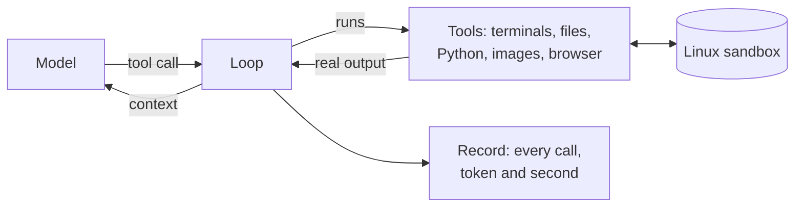

# Core

**Core is an AI agent that does real work on a computer.** You describe a job in plain words. Core works in a
Linux sandbox with terminals, files, Python and images until the job is done, checks its own result, and records
every step, token and second along the way.

It is plain Python with no agent framework underneath, and it runs one model at a time. Every result below is
from a real run with `gpt-6-luna`.

- [See it work](#see-it-work): real jobs, with time and cost
- [Try it in 60 seconds](#try-it-in-60-seconds): runs offline, no API key
- [How it works](#how-it-works)
- [How I build it](#how-i-build-it): fast to test, quick to remove
- [Hard problems solved](#hard-problems-solved)
- [Limits](#limits)

## See it work

Five jobs chosen because they look like real client work. Steps and checks for each: [RUNS.md](RUNS.md).

| Job | What Core did | Time | Cost |
|---|---|---|---|
| **Bank capital calculation** | Recalculated counterparty credit risk capital for two trading counterparties under the EU banking rules (SA-CCR, CRR3): 13 trades, a collateral agreement and disputed margin calls. Wrote a results file and a formula-driven Excel workbook, then checked both. | 17m 15s | $0.18 |
| **Design file from a picture** | Given a finished graphic and its image pieces, worked out the position, size, layering and text styling of every element and wrote them as a layout config. Rendered the config back: pixel-identical to the original. | 26m 42s | $0.19 |
| **3D part from an engineering drawing** | Read the dimensions off a technical drawing, zooming into each view, then wrote a FreeCAD script that builds the part as a proper parametric model. Reopened the file and checked it is one valid solid. | 12m 34s | $0.11 |
| **Invoices from a folder of scans** | Read 17 mixed documents (PDFs and phone photos) with OCR, sorted out the 10 invoices, and wrote a summary of totals and VAT. Checked every sum before finishing. | 5m 44s | $0.03 |
| **COBOL to Python** | Read an old COBOL program, ran it, rewrote it in Python, then ran both on the same inputs until every output matched byte for byte. | 4m 20s | $0.03 |

Also in [RUNS.md](RUNS.md): a walking, jumping and running robot trajectory generator in PyDrake (33m 45s,
$0.44), a leaked secret recovered from git history and then purged (1m 23s, $0.01), and a corrupted database
recovered with all 11 records (48s, $0.005).

These jobs come from Terminal-Bench, a public set of realistic computer tasks graded by hidden tests; the first
three are from version 4, the hardest set. Core does not solve the hardest tasks every time. These are chosen
successful runs, not success rates. Cost is model usage priced at
$0.25 / $0.025 / $0.90 per million input / cached / output tokens.

## Try it in 60 seconds

Needs Python 3.12+ and [uv](https://docs.astral.sh/uv/).

```sh
cd core
uv sync --frozen
uv run python examples/offline_smoke.py
```

This runs the real agent loop with a scripted model in place of an API, so it needs no key and no network. It
writes a file through Core's real tools and prints:

```
{"status": "finished", "actual_file": "hello from installed Aether\n", "network_calls": 0, "attempts": 2}
```

Run the tests with `uv run pytest -q`. Linux-only tests (PTY, Docker, process cleanup) skip on macOS.

**With a real model:** Core talks to any OpenAI-compatible endpoint through
[provider.py](src/aether/core/provider.py). For full task runs it plugs into
[Harbor](https://github.com/laude-institute/harbor): install the `harbor` extra and select
`aether.core.harbor_agent:AetherCoreAgent`.

## How it works



The model decides what to do and when the job is finished. Core runs the actions, tells the model exactly what
happened, keeps the context within budget, and records everything. It never decides the task for the model.

| Part | What it does | Where |
|---|---|---|
| Loop | Calls the model, runs its tool calls in order, enforces the deadline | [loop.py](src/aether/core/loop.py) |
| Terminals | Up to eight named shells that survive long commands, so a slow job keeps running while the model works | [terminal.py](src/aether/core/terminal.py) |
| Files | Line-numbered reads, exact edits, atomic writes that never leave a half-written file | [files.py](src/aether/core/files.py) |
| Python, images, browser | A persistent Python session, image viewing and cropping, a headless browser | [repl.py](src/aether/core/repl.py), [images.py](src/aether/core/images.py), [browser.py](src/aether/core/browser.py) |
| Context | Keeps long runs inside the model's budget, with a stable request prefix so the provider's cache stays warm | [context.py](src/aether/core/context.py), [clm.py](src/aether/core/clm.py) |
| Provider | Streaming calls, bounded retries, honest handling of dropped streams | [provider.py](src/aether/core/provider.py) |
| Record | Every model attempt logged before it is sent, with exact arguments, tokens and timing | [calls.py](src/aether/core/calls.py) |
| MCP | Connects to external tool servers over the Model Context Protocol | [mcp.py](src/aether/core/mcp.py) |

About 23,000 lines of Python in 120 modules, each under 500 lines, with 174 test files. Design notes:
[docs/ARCHITECTURE.md](docs/ARCHITECTURE.md).

## How I build it

Every change starts as a small experiment behind a switch. It runs on real tasks and is kept only if the numbers
say so. Most ideas are settled within a day, on a few dollars of runs.

Two that earned their place:

- **Cache-stable context:** keeping the start of every request identical roughly halved cost per run, with the
  same success rate.
- **Stable facts:** writing the run's state once instead of rewriting it every turn cut cost to 0.52x and 0.76x
  on two separate task sets, with the same passes. Now on by default.

The method with real examples: [BUILDING.md](BUILDING.md). What was tried, kept and removed:
[EXPERIMENTS.md](EXPERIMENTS.md).

## Hard problems solved

Agents usually fail in production for boring reasons. These came from real runs and testing and were fixed at the root, each
with a test that fails without the fix.

- **A dead tool server froze every later call.** When an MCP server process died, later calls waited out their
  full timeout. Core now checks the server is alive while waiting and recovers the requests it never answered.
- **A lost reply could run a command twice.** If the reply to a terminal command was lost, a retry could run it
  again. In-flight commands are now fenced, and a lost reply is resolved from the terminal's own records.
- **Files written to the wrong place.** A plain `mv` onto a path that became a folder mid-write reports success at
  the wrong location. Writes now commit the exact path with rename semantics.
- **Long reasoning cut off and lost.** A model turn cut by the output limit was being dropped. It is now kept,
  and the cut is shown to the model.

More, with the evidence: [docs/LESSONS.md](docs/LESSONS.md).

## Built with

Python 3.12, the OpenAI SDK, asyncio, Docker, Harbor, Playwright, MCP and Pillow. Ideas adapted from public agents
are credited in [THIRD_PARTY_NOTICES.md](THIRD_PARTY_NOTICES.md).

## Limits

- One model at a time, tested mainly with `gpt-6-luna`.
- The hardest tasks are not solved every time. The runs above are chosen examples.
- Built for Linux sandboxes. Some features skip on macOS.
- The offline tests prove the mechanics work, not how good the model is at a task. Task-level results come from
  real runs, kept in the research record.

## More

Core comes out of a research programme on what an agent harness should add to a model. That work, including the
experiments behind each decision, is in [../research/](../research/). The overview is on the
[front page](../README.md).
